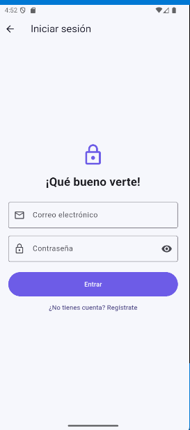
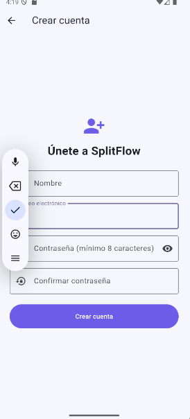
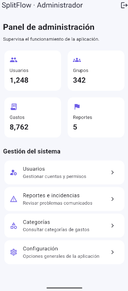
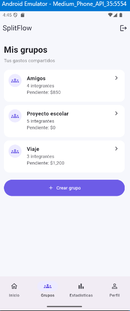
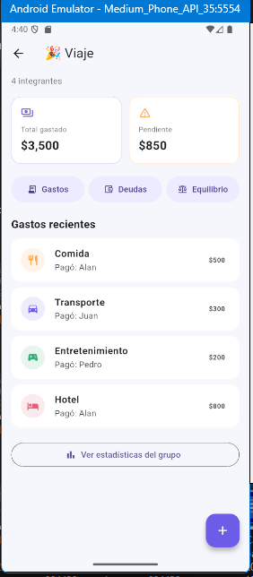
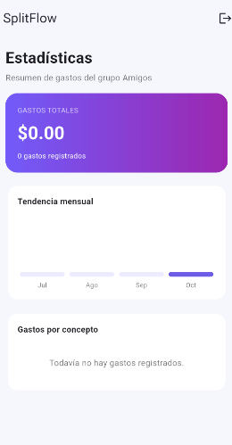
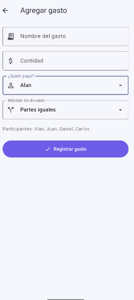
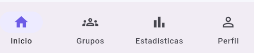

# SplitFlow

## 1. Descripción breve
SplitFlow es una aplicación móvil desarrollada en Flutter diseñada para facilitar el control, gestión y división de gastos en grupo de manera equitativa y transparente. Permite registrar usuarios, administrar presupuestos compartidos y llevar un historial detallado de movimientos.

## 2. Los 3 tipos de usuario y sus dashboards
* **Administrador:** Control total de la aplicación, gestión de usuarios, creación de grupos principales y supervisión de balances globales.
* **Cliente / Miembro:** Usuario regular que puede unirse a grupos, visualizar listas de gastos compartidos y registrar sus propios aportes o consumos.
* **Operador / Invitado:** Rol con permisos de lectura y consulta de movimientos y estadísticas dentro de los grupos asignados.

## 3. Manejo de estado elegido (y por qué)
Se utilizó **StatefulWidget y setState / Provider** para la gestión de estado local y global de la aplicación. Se eligió este enfoque debido a la necesidad de reflejar de forma inmediata los cambios en tiempo real al agregar nuevos gastos, actualizar listas y persistir la sesión activa del usuario al navegar entre pantallas.

## 4. Cómo ejecutar la app
1. Asegúrate de tener instalado **Flutter SDK** y un entorno configurado (Android Studio / VS Code).
2. Clona este repositorio:
   ```bash
   git clone [https://github.com/1225100294ddt/split_flow.git](https://github.com/1225100294ddt/split_flow.git)
## 5. Demostración al docente
- Dispositivo/emulador usado: android 
- 26/10/2026 presencial
## 6. Screenshots

### Splashscreen


### Autenticación



### Dashboards



### Listas




### Formularios


### Evidencia funcional


